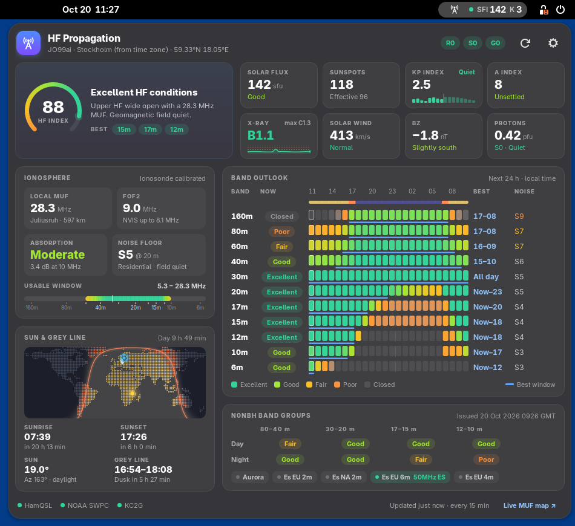
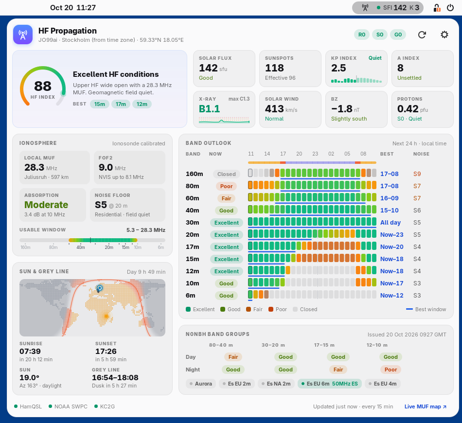

# HF Propagation for GNOME Shell

A live HF propagation dashboard in your GNOME top bar, for radio amateurs.
It brings together solar and geomagnetic indices, ionosonde measurements and a
local propagation model. From that it shows **which bands are open now**, **how
they will develop over the next 24 hours** and **when the best operating window
on each band is**.



<details>
<summary>Light style</summary>



</details>

## What it shows

| Section | Contents |
| --- | --- |
| **Top bar** | Antenna icon, overall condition dot, SFI and K index. MUF and the best band can be added in settings |
| **Summary** | Overall HF index (0–100) gauge, a plain-language headline (including radio blackouts, geomagnetic storms and proton events) and the best bands right now |
| **Solar & geomagnetic** | Solar flux, sunspot number (and effective SSN), Kp with a 24 h history and forecast chart, A index, GOES X-ray class with a 6 h sparkline, solar wind speed, Bz and proton flux, plus the NOAA R/S/G space-weather scales |
| **Ionosphere** | Local MUF (calibrated with nearby ionosondes), foF2/NVIS limit, D-layer absorption level, noise floor in S-units and the usable frequency window (LUF–MUF) across the HF spectrum |
| **Sun & grey line** | Dot-matrix world map with day/night, twilight shading, the grey line, the sub-solar point, your station and the ionosondes in use. Also sunrise, sunset, sun elevation and azimuth, and the next grey-line window with a countdown |
| **Band outlook** | 160 m – 6 m: the condition now, a 24-hour heat strip with day/night bar, the **best time window** per band and the expected noise floor |
| **N0NBH band groups** | N0NBH's day/night conditions and VHF phenomena (aurora, sporadic-E) for reference |

## How conditions are calculated

The band outlook combines several inputs:

* **MUF / foF2:** an empirical F2 model driven by the effective sunspot number
  (derived from SFI). It accounts for solar zenith angle, the slow post-sunset
  decay, season (winter anomaly), latitude and geomagnetic storms. It is
  calibrated in real time against the nearest ionosondes (KC2G/GIRO) within
  2500 km.
* **Absorption:** D-layer absorption from zenith angle and solar activity, plus
  X-ray flare absorption (NOAA D-RAP relation), polar cap absorption during
  proton events and auroral absorption during storms.
* **Noise:** ITU-R P.372 man-made noise for your chosen environment, plus
  galactic, atmospheric and geomagnetic noise.
* **Sporadic-E and aurora:** seasonal and diurnal Es climatology, boosted by
  N0NBH's live VHF reports.
* **N0NBH band groups:** blended in as a reference.

Each band receives a score for each hour. The *best window* is the
highest-scoring contiguous block of hours in the next 24 hours.

It is a forecast tool, not a ray tracer. Use it to decide *when* and *where* to
listen, then trust your receiver.

## Installation

Requires GNOME Shell 46 – 51 (tested on 46, 50 and 51).

```bash
git clone https://github.com/mashu/hf-propagation.git
cd hf-propagation
./install.sh
```

On Wayland, GNOME Shell only discovers new extensions at login. Log out and
back in, then enable it with `gnome-extensions enable hf-propagation@mashu.github.io`
or the Extensions app.

To build a zip for `gnome-extensions install` run `./install.sh --pack`. To
remove the extension run `./install.sh --uninstall`.

### Publishing on extensions.gnome.org

Upload the zip created by `./install.sh --pack`, never a zip of the
repository folder. The packed zip contains only the files GNOME Shell loads
(`extension.js`, `prefs.js`, `metadata.json`, the stylesheets, `lib/`,
`icons/` and the schema XML), as the review guidelines require. It leaves out
the install script, README, screenshots and compiled schemas.

## Settings

Open the settings from the gear button in the dashboard, or with
`gnome-extensions prefs hf-propagation@mashu.github.io`:

* **Station location:** automatic (from the time zone), a Maidenhead locator
  or latitude/longitude. Set your locator for accurate local MUF, sun and grey
  line results.
* **Noise environment:** quiet rural, rural, residential or city.
* **Top bar:** position and which values to show.
* **Data:** refresh interval, ionosonde calibration and UTC/local time.

## Data sources

* [N0NBH / HamQSL](https://www.hamqsl.com/solar.html): solar indices,
  band group conditions and VHF phenomena
* [NOAA SWPC](https://www.swpc.noaa.gov/): Kp (now, history and forecast),
  GOES X-ray flux and the space weather scales
* [KC2G](https://prop.kc2g.com/): real-time ionosonde MUF and foF2
* [Natural Earth](https://www.naturalearthdata.com/): coastlines for the
  world map (public domain)

Data is refreshed every 15 minutes by default. The last good data is cached so
the dashboard is filled straight away after login.

## Troubleshooting

```bash
./install.sh --status                                      # what GNOME Shell has loaded
gnome-extensions info hf-propagation@mashu.github.io      # State should be ACTIVE, Version 2.0 (2)
journalctl -f -o cat /usr/bin/gnome-shell | grep 'HF Propagation'
```

* **"Incompatible with the current version of GNOME" / OUT OF DATE:** GNOME
  Shell is still running an older copy, read at your last login. Run
  `./install.sh`, then log out and back in. Note that the version that matters
  is the `gnome-shell` package (`gnome-shell --version`), not `gnome-session`.
  During distribution upgrades these can differ (e.g. session 51 with shell 50).
* **Nothing changes after updating:** log out and back in, because GNOME Shell
  caches loaded extension code.

## Changes in 2.0

* Fixed loading on GNOME Shell 49 – 51. `St.BoxLayout` no longer has a
  `vertical` property, and the metadata only listed GNOME 45 – 48.
* Ported to the `Extension` base class. Proper cleanup on disable, and no
  async `disable()`, as GNOME 51 requires.
* New dashboard UI with light and dark styles, custom-drawn charts and a world
  map.
* New features: local MUF with ionosonde calibration, absorption, noise floor,
  sun and grey line, 24 h band outlook with best windows, NOAA scales, Kp
  forecast, X-ray history, settings.
